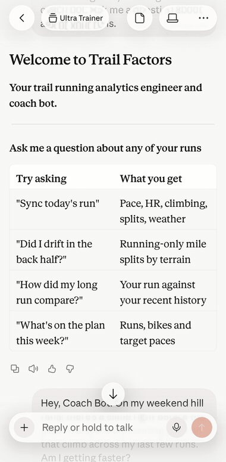
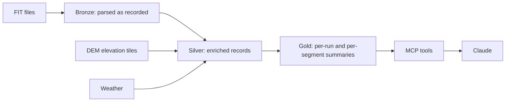
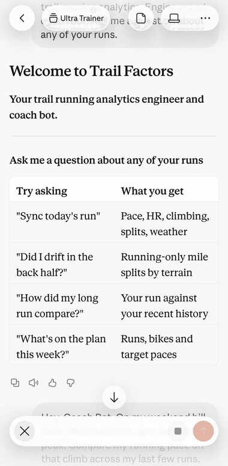
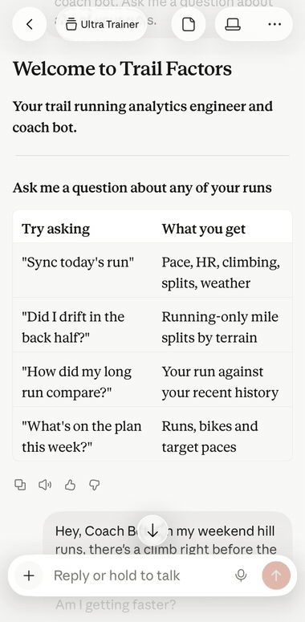
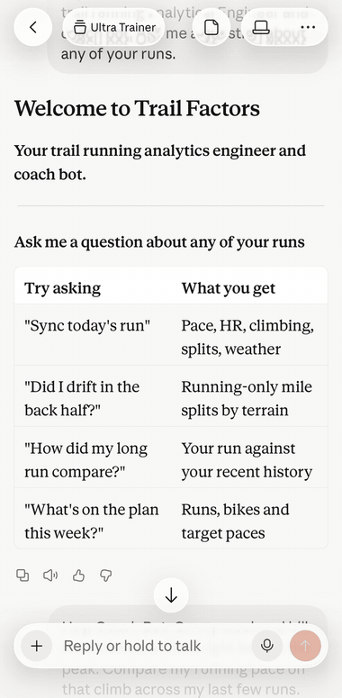
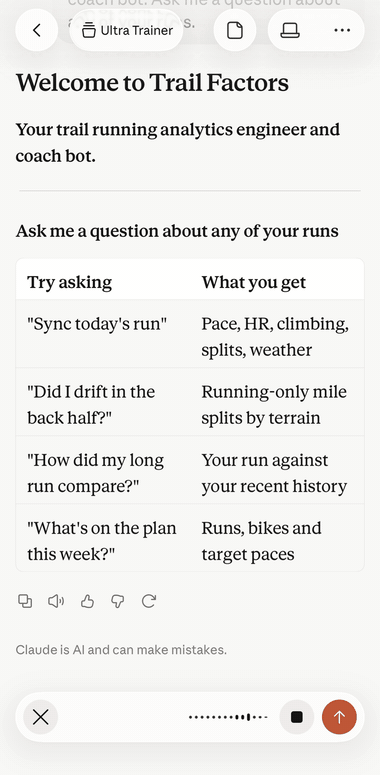

# Trail Factors

Trail and ultra running analysis from your own Garmin FIT files, served to Claude through a local MCP server.

[](https://github.com/cambroussard9/trail-factors/actions/workflows/ci.yml)
[](LICENSE)
<!-- SonarQube badge goes here -->

<p align="center">
  
</p>
<p align="center"><em>Recorded on my phone with my own data, in a Claude Project that holds my coaching notes. The repo is the analytics layer.</em></p>

## Why I built this

I'm training for my first 50-mile trail race. Garmin Connect reports averages, and on rolling trail terrain averaging destroys the signal: an average heart rate across eight climbs can't tell me whether I was tired or the trail was hard. Trails add a second problem. Under ridges and in creek drainages, GPS coverage drops out, and elevation read from a drifting position turns into noise.

So I built my own analytics layer and connected it to the AI chat I use for coaching. Trail Factors takes FIT files from my watch, loads them into a local DuckDB database, refines them through a medallion architecture (raw bronze, enriched silver, summarized gold), and exposes the gold layer to Claude through an MCP server. Elevation comes from a digital elevation model instead of the watch, so the same hill returns the same profile every time. I ask questions in plain English and get answers computed from my own data: running-only pace by grade, heart rate drift on matched terrain, the same hill compared across months.

Two design rules shaped it:
- The tools carry the filters. The chat never queries the database directly. Every number comes through a tool that applies the gates and exclusions that make it trustworthy, and if a tool can't answer a question, it says so.
- The athlete outranks the instrument. When the data and my account of a run disagree, the first question is what the measurement couldn't see, like a GPS dead spot in a creek drainage or a watch that died mid-run.

I built it in VS Code with the Claude Code extension. I designed the system and wrote the specs; Claude Code wrote most of the code. I use it after nearly every run.

## How it works



Raw FIT files are the immutable source of truth. The database is derived from them, with athlete-supplied state re-applied, and can be rebuilt. Elevation is looked up locally from downloaded USGS 3DEP tiles rather than taken from the watch, so no per-coordinate query leaves the machine and the same trail returns the identical profile on every traversal. The MCP server is a thin wrapper over the same functions the CLI calls: it runs over stdio only and opens every database connection read-only.

More detail: [docs/ARCHITECTURE.md](docs/ARCHITECTURE.md), [docs/tools.md](docs/tools.md) (all 29 MCP tools), [docs/HISTORY.md](docs/HISTORY.md), and [SPEC.md](SPEC.md) (the full design).

## What you can ask

Each clip is a question asked out loud and answered from my own data.

<table>
  <tr>
    <td width="50%" valign="top">
      <br>
      <b>"Look at my last run on that Rim Ridge trail. Can you break that run into laps, showing running pace, elevation, heart rate for each lap, and any other metric you might think is pertinent to compare lap by lap?"</b><br>
      Mile-by-mile running pace with the walks removed, plus elevation, walk time and cadence.
    </td>
    <td width="50%" valign="top">
      <br>
      <b>"My last couple weekend hilly runs, how does that track compare to my upcoming races course profile in terms of elevation?"</b><br>
      Recent hill runs compared with the climbing profile of target races.
    </td>
  </tr>
  <tr>
    <td width="50%" valign="top">
      <br>
      <b>"I wanted to look at my last two interval runs and look at my heart rate recovery. Like, how long does it take my heart rate to recover between these intervals?"</b><br>
      Heart-rate recovery during walk breaks across two interval runs.
    </td>
    <td width="50%" valign="top">
      <br>
      <b>"On my weekend hill runs, there's a climb right before the peak. Compare my running pace on that climb across my last few runs. Am I getting faster?"</b><br>
      One climb compared across runs; when the data is too thin, it says so instead of guessing.
    </td>
  </tr>
</table>

### Try it yourself with the demo data

These answers come from the bundled demo database (`data/demo.duckdb`, built by `uv run trail-factors demo`), not from a live account.

**"On my most recent long run, show my running pace per mile and when my heart rate started to drift."** → `mile_splits()` and `drift_onset()`

The most recent long run in the demo is 2026-10-11: 7.62 mi in 106 minutes. Pace counts running time only; walk breaks are left out of the pace and shown in their own column.

| Mile | Running pace | HR (running) | Walking |
|---|---|---|---|
| 1 | **11:12/mi** | 129 | 0:00 |
| 2 | **13:26/mi** | 162 | 1:48 |
| 3 | **13:53/mi** | 154 | 8:02 |
| 4 | **12:57/mi** | 162 | 7:14 |
| 5 | **11:49/mi** | 168 | 6:55 |
| 6 | **10:53/mi** | 164 | 2:14 |
| 7 | **12:12/mi** | 168 | 5:56 |
| 8 (0.62 mi) | **11:46/mi** | 175 | 3:11 |

Garmin's own lap for mile 2 reads 14:05/mi because it includes the walking; it is returned beside these figures for cross-checking and never substituted for them.

On drift, the tool finds an onset at **85 minutes**: the first 5-minute bin where heart rate on matched ground drifts upward and keeps drifting upward in every later bin (dew point 63–66 °F). It also refuses to call that a finding. Only **1 of 7** demo runs recorded every second produces an onset, and **8** at a comparable dew point are needed before anyone can tell whether the onset repeats. So the 85 minutes is reported as a diagnostic, with the reason attached.

**"Is my heart rate drifting on the same ground?"** → `matched_terrain_drift()`

"matched_terrain_drift: median **9.79 bpm/hour** over 9 of 10 runs." It pairs records on the same ground (within 20 m, at least 600 s apart, both running, speed matched within 0.35 m/s). The tenth run had no qualifying pairs, and the result says so instead of reporting a number.

**"What training load have I done recently?"** → `session_load(last_n=11)`

"6 of 11 sessions priced, **2625 AU** (a lower bound: 5 unpriced)." Load is Garmin's post-run RPE × timer minutes. The five runs with no Garmin self-evaluation are left out rather than counted as zero, so the total is labelled a lower bound.

## Quick start

Requires Python 3.12, [uv](https://docs.astral.sh/uv/) and [Claude Code](https://claude.com/claude-code). The demo needs no Garmin account and no network.

```sh
git clone https://github.com/cambroussard9/trail-factors.git && cd trail-factors
uv sync
uv run trail-factors demo
```

Register the MCP server with Claude Code, from the clone root:

```sh
claude mcp add trail-factors -e TRAIL_FACTORS_DB=data/demo.duckdb -- uv run --directory "$PWD" trail-factors-mcp
claude mcp get trail-factors      # or: claude mcp list
```

Then ask Claude one of the [demo-data questions above](#try-it-yourself-with-the-demo-data).

Using Codex instead? See [SETUP.md, step 11](SETUP.md#step-11-register-the-mcp-server-with-codex-from-openais-docs-untested) (from OpenAI's docs, untested).

## Use your own Garmin data

Copy `config/athlete.example.yaml` to `config/athlete.yaml`, log in once with `uv run trail-factors garmin-login`, and run `uv run trail-factors sync` to download, ingest and validate your activities. Your data stays in the gitignored `data/` directory on your machine. The full walkthrough is in [SETUP.md](SETUP.md).

## Security and quality

| Control | Where | Why it exists |
|---|---|---|
| gitleaks | pre-commit (`.pre-commit-config.yaml`) | Blocks a commit whose staged changes contain a secret. |
| ruff (lint + format) | pre-commit (`.pre-commit-config.yaml`) | Keeps style and common errors out of commits. |
| ruff and pytest | CI (`.github/workflows/ci.yml`), every push and pull request | Installs from the lockfile, checks lint and formatting, runs the tests. Corpus tests skip because no database is set. |
| TruffleHog | `.github/workflows/secrets.yml`, every push | Scans the full git history and fails on any verified or unknown finding. |
| Dependabot | `.github/dependabot.yml` | Proposes weekly updates for GitHub Actions and the uv-managed Python dependencies. |
| Secrets-blocking hooks | The author's own Claude Code user settings (not shipped in this repo) | SonarQube secrets hooks run on prompt submit and before file reads. They need the `sonar` CLI. |

More in [SECURITY.md](SECURITY.md).

## Testing

Tests built on synthetic fixtures run anywhere. Corpus tests read a real database named by `TRAIL_FACTORS_DB` and skip when none is set, so the same suite gives different counts depending on what it runs against.

| Run against | Result | What it shows |
|---|---|---|
| CI, every push | 726 pass, 430 skip | Everything that needs no private data passes. The 430 corpus tests skip because they need real runs. |
| The demo database | 1,064 pass, 92 skip | The corpus tests run against the bundled demo runs. Reproduce it with the commands below. |
| The author's private corpus | 1,123 pass | The analysis holds up on real recordings (GPS gaps, watch and phone duplicates, DEM elevation), which synthetic fixtures can't cover. |
| The private build this was extracted from | 1,122 tests | That build includes features not published here. |

To reproduce the demo-database run:

```sh
uv run trail-factors demo                          # builds data/demo.duckdb
TRAIL_FACTORS_DB=data/demo.duckdb uv run pytest
```

Counts as of 2026-11-03.

## Design principles

- **Tools carry the filters.** MCP tools are parameterised primitives that never take SQL: the selection is free, the computation is fixed, and every result states its applied filters and what it excluded. Every report section carries one of four statuses (`ok`, `gated`, `refused`, `unavailable`), never a bare null.
- **The athlete outranks the instrument.** A file the validator rejects names its own fix, and the athlete confirms the valid window with `confirm-file`; the window is applied before validation, so a car ride at the end of a recording no longer sinks the run.
- **The database rebuilds from raw FIT.** Files in `data/raw/` are immutable and never edited. The database is derived from them, with athlete-supplied state re-applied, so deleting it and re-running ingest is safe. Athlete-supplied state (window confirmations, segment names, notes) lives in `data/athlete/`, outside the rebuild path, because nothing can regenerate it. It is gitignored with the rest of `data/`, so back it up yourself.

## Known limitations

Known issues and limitations are tracked in [GitHub issues](https://github.com/cambroussard9/trail-factors/issues). The constraints built into the design:

- **One athlete by design.** No multi-tenancy, no app, no web UI.
- **Terrain needs a DEM tile.** Grade and elevation come from USGS 3DEP tiles, which cover the United States only; `fetch-tile` refuses a cell outside US territory before sending any request. A run with no tile on disk gets no terrain numbers, and the report says which tile is missing.
- **Garmin download uses an unofficial library** (`garminconnect`). Garmin can throttle its login, and a failed login locks further attempts locally for 30 minutes.
- **The MCP server runs over stdio only.**

## Built with

[VS Code](https://code.visualstudio.com/) and the [Claude Code](https://claude.com/claude-code) extension.

## About me

<!-- Replace YOUR-LINKEDIN-URL with your LinkedIn profile URL. -->
[LinkedIn](YOUR-LINKEDIN-URL)

## License

MIT. See [LICENSE](LICENSE).
