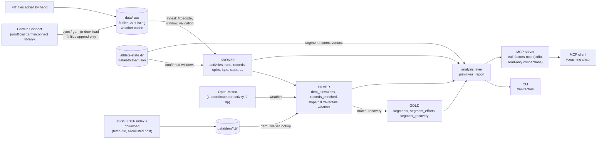

# Architecture

This page shows how Trail Factors turns Garmin `.fit` files into the numbers a
coaching chat reads. It is a map. The detail, and the measurements behind each
decision, are in [SPEC.md](../SPEC.md), cited by section (§) throughout.

## Principles

- **Raw files are the source of truth, and the code never changes them.**
  Everything in the database is derived from `data/raw/` and can be rebuilt.
  Delete the database and re-ingest to get it back (§3, §11).
- **What the athlete supplies lives outside the rebuild path.** Window
  confirmations, segment names, venues, notes and ride logs are JSON files in
  the athlete-state directory (`data/athlete/` by default). Ingest reads them
  and never writes them. They cannot be regenerated, so back them up (§4.3).
- **Identity is UTC.** `run_id`, every timestamp and every time-range join use
  naive UTC. Local time is used only for display and for grouping by day (§3).
- **Store SI units and format late.** Nothing stores a pace. Pace is formatted
  as `M:SS/mi` at display time by `src/trail_factors/units.py` (header of
  SPEC.md).
- **A missing layer narrows the output and leaves the run usable.** A run
  with no DEM, no weather or no segment match still has valid HR, pace,
  cadence and distance. The output says which layers were available (§3.1).

## Data flow



## Layers and tables

The schema is in `src/trail_factors/ingest/schema.py`. It is applied,
idempotently, by `ensure_schema()` (`cli/common.py`), which the CLI's database commands call
before they run (§4.3). `retile` is the exception: it opens its write
connection directly and relies on the schema already being there. The MCP
server opens read-only connections and never applies it. The layer names follow §3.

| Layer | Tables and views | Written by |
|---|---|---|
| **Bronze**: the file as recorded | `ingest_ledger` (one row per file, keyed on its SHA-256), `runs`, `activities`, `records`, `splits`, `laps`, `stops`, `activity_hr_zones`, `validation_results` | `ingest` / `ingest-all` (and `sync`); the gold-layer checks in `validation_results` come from `validate` |
| **Silver**: derived and enriched | `dem_elevations`, `records_enriched` (grade, grade-adjusted pace, `quality_flags`), `slope_traversals`, `hill_traversals`, `weather_hourly`, `weather_records` | `dem`, `silver`, `weather` |
| **Gold**: summaries the coaching layer reads | `segments`, `segment_efforts`, `segment_recovery` | `match`, `recovery` |
| **Views** | `records_valid` (records inside the valid window), `run_summary` (moving and elapsed pace side by side), `terrain_blocks` (positioned blocks usable for terrain) | defined in the DDL |
| **Projections of athlete state** | `window_confirmations`, `annotations` | restored from `data/athlete/` when the schema is ensured |

Gold also has a computed layer that is not stored. The §6 primitives
(`src/trail_factors/analysis/primitives.py` and its siblings) and the §16.2 post-run report
(`src/trail_factors/analysis/report.py`) are computed when they are read. Every report
section has one of four statuses: `ok`, `gated`, `refused` or `unavailable`.
None of them is ever a bare null (§16.2).

**Dual recording.** A run can be recorded by both a watch and a phone. Each
file becomes its own `activities` row, and the rows share one `runs.run_id`.
The §6 primitives use one activity per `run_id`. The matcher does the same
and prefers the watch recording, because the watch is the only source of
heart rate (`load_traversals` in `cli/terrain.py`, §3).

## From a FIT file to rows

The code is in `src/trail_factors/ingest/`:

1. **Identity.** `fit_file.sha256()` hashes the file. The content is the
   identity and the filename is not. The activity id is the first 16 hex
   characters of that hash. Re-ingesting the same file replaces its rows and
   never duplicates them (`load.py`).
2. **Parse.** `fit_file.read_messages()` reads every data message with
   `fitdecode`. `source` (watch or phone) comes from the file's manufacturer
   field, never from the folder it sits in. The sampling regime (1 Hz or
   Smart Recording) is detected from the median gap between records (§3, §9).
3. **Window.** If the athlete has confirmed a valid window for this file, it
   is applied **before validation** (see below).
4. **Validate.** Bronze checks (parse fidelity) and silver checks (physical
   plausibility) run inline. A FATAL finding writes no activity row. The
   findings are still committed to `validation_results`, keyed on the file
   hash, so a rejected file stays visible (§4.2).
5. **Write.** In one transaction, ingest clears this file's earlier rows,
   attaches the file to a `run_id`, inserts the ledger and activity rows by
   column name, then inserts the records, splits, laps, stops and per-file
   HR zones. Two files belong to the same run when the sport matches and
   their start times and time ranges overlap within a tolerance (`load.resolve_run`, §3).

Gold validation compares a run with the rest of the corpus, so it runs as a
separate pass (`validate`). Running it inline would make the results depend
on ingest order (§4.2).

## Validation and the confirmed window

Validation writes rows and never raises them away. `validation_results`
carries `file_sha256` (always), `activity_id` and `run_id` (when they exist),
a severity (`fatal`, `warning`, `info`) and the observed and expected values
as numbers, so a threshold can be queried (§4.2).

A stationary tail at the end of a recording, such as a forgotten stop or a
drive home, is never truncated automatically (§4.3):

- The detector records a **suggested** window as a WARNING. A file whose tail
  reads as a sustained impossible speed is rejected as FATAL.
- The athlete confirms a window with
  `uv run trail-factors confirm-file <garmin-id> --end 'YYYY-MM-DD HH:MM:SS'`
  (UTC), or `confirm-window` for a file that did ingest.
  `uv run trail-factors rejected-files` lists every rejection still
  outstanding, with the exact command for each. The confirmation is written
  atomically to `window_confirmations.json` in the athlete-state directory,
  with its earlier revisions kept.
- The next `sync` or `ingest-all` applies the window **before validation**.
  A split wholly outside the window is dropped. A split that straddles the
  edge is truncated, and its distance is recomputed from the records rather
  than scaled. Session totals are recomputed, and Garmin's whole-file totals
  are kept in `*_whole_file` columns. A window that selects zero records
  raises an error.
- Mid-run stops are never trimmed. They are kept as structure in `stops`.
- Confirming a window is CLI-only. No MCP tool writes one.

The full loop, including how the advice handles a car stretch followed by
walking and a mid-run impossible block, is in §4.3 ("The bad-data loop").

## Elevation: the DEM, not the watch

A GPS-only watch writes GPS-derived altitude, and vertical is GPS's weakest
axis. So silver ignores the watch's altitude for terrain and looks elevation
up in **USGS 3DEP 1 m lidar tiles** instead. The same trail returns the same
profile on every traversal (§5a). The watch's own altitude stays in bronze as
`records.altitude_device_m`, with its provenance measured per file (§9.2).

- **The lookup is local.** No per-coordinate query goes to any external
  service, because a stream of positions is a route trace. `dem.py` opens no
  socket, and nothing on the lookup path imports the fetch module. Both rules
  are asserted in `tests/test_fetch_tile.py` (§5a.1).
- **`TileSet`** (`src/trail_factors/transform/dem.py`) treats every `.tif` in the DEM
  directory as one surface, so installing a tile means dropping it in that
  directory. A point outside every tile raises `OutsideTile` rather than
  returning NoData. The report's `terrain_coverage` then names the missing
  10 km cell and the command that fetches it (§14p).
- **Each tile reads its own CRS** from its `ProjectedCSTypeGeoKey`. A tile
  from another UTM zone is therefore never placed in the wrong frame
  (§5a.1-quater).
- **`fetch-tile` resolves the tile, never constructs its name.** It queries
  the 3DEP index with the cell's ground as a WGS84 bounding box. When several
  products cover the cell, it picks the largest. Downloads come only from
  allowlisted HTTPS hosts, and a redirect off the allowlist is refused. Each
  tile is verified (byte count, strip extents, CRS key, georeferencing)
  before it is moved into place. Then `retile` runs for the activities the
  new tile covers (§5a.1-bis).

```sh
uv run trail-factors fetch-tile --missing         # every cell a report named
uv run trail-factors fetch-tile <cell> --zone NN  # one cell (copy fetch_command)
```

## Projection

Silver and the matcher do their planar geometry in metres, so each run needs a
projected CRS (§5a.1-quinquies):

- **A configured `projection_crs` wins.** If `config/athlete.yaml` sets one,
  every run uses it, and segment ids do not depend on a zone.
- **Otherwise the UTM zone is derived for each run** from the median of that
  run's own positions (`EPSG:326NN` north, `EPSG:327NN` south). The output
  labels it as derived, so a reader can tell a choice from an inference.
- **When the zone is derived, it is part of segment identity.** Each UTM zone
  is its own coordinate frame, so places in different zones never match.
  Missing DEM cells are named in the same derived zone, which is why
  `fetch-tile` then needs `--zone`.
- **Known limitation.** Suppose two runs cross the same summit but their
  median positions fall on opposite sides of a zone line. The slope then
  forms two segments, and nothing in the output says why. Setting
  `projection_crs` removes the problem (§5a.1-quinquies, §12.6).

## The segment matcher

The aim is to tell that "hill 3 on lap 5 is hill 3 on lap 1, three months
ago" without matching GPS traces against each other or against any external
trail data (§5).

- **The unit is a slope**, meaning one monotonic stretch of terrain. Silver
  finds slopes by labelling the DEM grade profile as ascent, descent or flat
  at ±3% (`SLOPE_ENTER_PCT`). It then absorbs short, insignificant
  interruptions into the slope around them (`detect_slopes` in
  `transform/silver.py`). An ascent and a descent of the same face are two
  **efforts** on one **segment**. Segments are direction-free places, and
  `segment_efforts.direction` holds the direction (§5, §5.4).
- **Identity is `(place, side)`.** The place is the prominence peak that a
  slope hangs from, because peaks reproduce far better than cols. The side is
  the flank, told apart by bearing. The col is never keyed on (§5.3, §5.4).
- **Matching is structural.** Two traversals are the same place only if they
  share a frame, sit within `MATCH_RADIUS_M = 30.0` m of each other, have
  place elevations within `ELEV_TOL_M` and lie on the same side
  (`transform/matcher.py`). A run on a new trail therefore creates new
  segments and cannot merge into old ones (§12.3).
- **Segment ids are content-derived.** Each id is a hash of the founding
  traversal's endpoints, with the zone added when the zone is derived. The
  library is rebuilt corpus-wide by `match`, and `recovery` must run after it
  (§12.3, §12.4).
- **Reference-run ordering is optional.** If `reference_run_garmin_id` is set
  in the config, segments are ordered and labelled along that run ("the climb
  at 1.0 km"). If it is unset, segments are listed by effort count.
- **Names are run-anchored and coordinate-free.** A segment name is stored as
  `(run_id, direction, at_distance_m)` in `segment_names.json`. It resolves to
  whichever segment that traversal belongs to after a rebuild (§19.3, §19.7).

### Venues (§19)

A training cluster can pool several distinct venues. A venue is defined by a
few **anchor segments** that the athlete names in `venues.json`. A run belongs
to a venue if it crosses one of that venue's anchors. A run that touches two
venues goes to the one carrying at least 60% of the anchor distance it
crossed; below that it is `mixed`. A run that is `mixed`, `unassigned` or
`none` falls back to the cluster, and the output labels it. Comparison sets
narrow cluster, then venue, then run_type, and each step applies only where it
leaves at least 3 members. In this build the run_type step is always skipped,
because run_type is not collected, and the `rule` string says so. `venue-candidates` proposes anchors and writes
nothing. Naming a venue is the athlete's act.

## Weather

For each positioned activity, `weather` sends one coordinate (its first
recorded position, rounded to 2 decimal places) to Open-Meteo. It uses UTC
timestamps and fetches an hourly series.
The series is interpolated per record into `weather_records`. Wind direction
is carried by the nearest observation and never interpolated. Every row
carries `weather_source` (`forecast`, `era5` or `assumed_indoor`), and the
ERA5 archive replaces forecast rows once it catches up. Raw responses are
cached under `data/raw/weather/`, so a rebuild needs no network (§8).

## The MCP layer

`src/trail_factors/mcp_server.py` is the door a coaching chat uses (§12.6). The tool list is
in [docs/tools.md](tools.md), which is generated by `scripts/gen_tools_doc.py`.

- **Thin wrapper.** Every tool calls the same function the CLI calls. The
  server holds no SQL, no thresholds and no interpretation.
- **stdio only.** The server is a child process of the client that launched
  it and binds no host or port. The server name is `trail-factors`.
- **Read-only connections, opened for each call.** Every DuckDB connection is
  `read_only=True`. DuckDB allows one writer, so a connection gets 5 s and then
  reports the lock by name instead of hanging.
- **The boundary is athlete input versus computed values.** A chat may submit
  athlete input through a validated contract. In this build that is only
  `save_ride_blocks`, which writes to the athlete-state directory. Nothing
  reachable from a tool modifies a computed value or a `.fit` file. The
  `sync` job does write to `data/raw/`: its download only appends new `.fit`
  files, and its weather step rewrites a cached Open-Meteo response when the
  ERA5 archive replaces a forecast.
- **One envelope.** Every tool returns `tool`, `outcome`, `payload`, `text`,
  `problems`, `remedy`, `retryable`, `corpus_fingerprint` and `calc_version`,
  and tools never raise. The `outcome` is one of `result`, `rejected`,
  `absent`, `refused` or `broken`. That vocabulary is deliberately separate
  from the report's four per-primitive statuses. `retryable` has one written
  definition (`RETRYABLE_MEANS`): is there a next call that can succeed?
- **Fixed computations with a free selection.** There is no arbitrary SQL and
  no access to bronze. Selections use one filter vocabulary: `run_type`,
  `start_date`, `end_date`, `cluster`, `last_n`, `segment_id` and `direction`
  (`src/trail_factors/analysis/select.py`). A filter a tool cannot honour is
  rejected by name, never dropped silently.
- **`run_type` is not collected in this build.** The parameter stays on
  every tool, but a non-empty value is rejected ("no run_type source in this
  build"), and every row reports `run_type: null` labelled "not collected"
  (`src/trail_factors/ingest/answers.py`, §16.6).
- **`sync` is a job.** It holds the write lock for minutes, so it returns a
  job id at once, and `sync_status` polls it. The job downloads over a 400-day
  window, then runs ingest, dem, silver, weather, match, recovery and
  validate. With no DEM tiles, it skips the terrain steps and adds a note
  saying why. The CLI `sync` does less: it stops before the terrain steps,
  and those are run afterwards with `retile` or one command at a time (§8).

## Where to read more

| Topic | SPEC.md |
|---|---|
| Layer architecture, degraded layers | §3, §3.1 |
| Validation, the valid window, the bad-data loop | §4.2, §4.3 |
| Terrain identity and the slope unit | §5, §5.0, §5.4, §12.3, §12.4 |
| DEM, `fetch-tile`, per-tile CRS, projection | §5a, §5a.1 to §5a.1-quinquies |
| Weather | §8 |
| FIT parsing details | §9 |
| MCP server and parameterised primitives | §12.6 |
| Quality flags | §15.4 |
| The post-run report | §16.2 |
| Venues | §19 |
